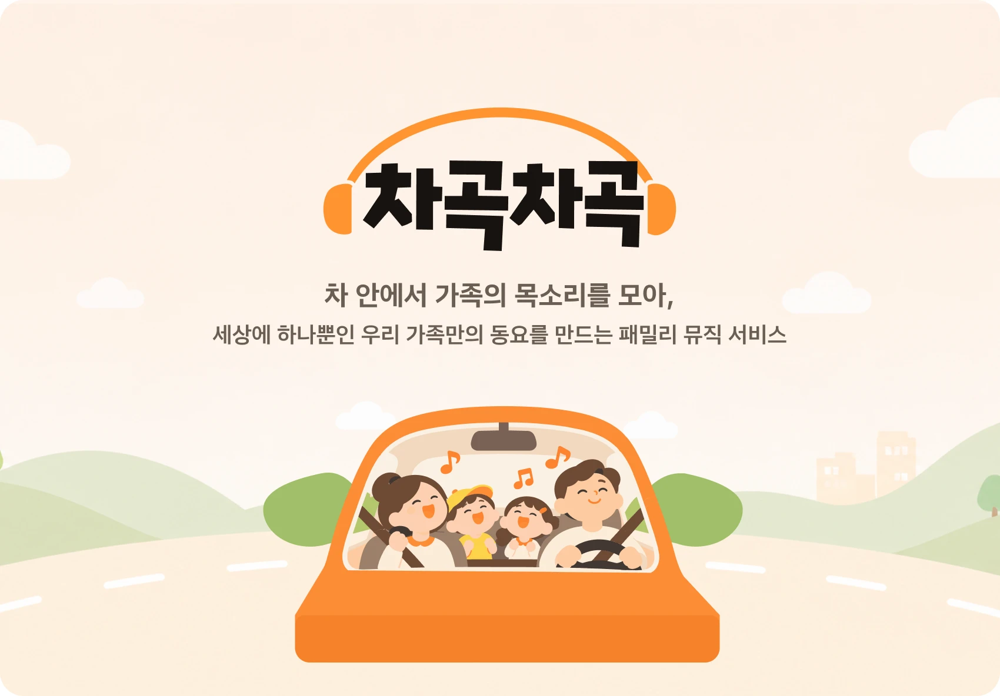

<p align="center">
  
</p>

<h1 align="center">차곡차곡</h1>

<p align="center">
  출발부터 도착까지 차가 달리는 리듬 위에 가족의 목소리와 악기가 하나씩 더해져,<br>
  드라이브마다 우리 가족만의 노래가 완성되는 차량용 가족 음악 앱<br>
  <b>팀 스포티카이</b> · 현대자동차그룹 차량용 앱 개발 공모전
</p>

<p align="center">
  
</p>

## 어떤 앱인가요

차곡차곡은 Pleos Connect(Android Automotive) 차량에서 돌아가는 가족용 동요 만들기 앱이에요. 드라이브하는 동안 아이와 가족이 나눈 말이 가사가 되고, 차가 달리는 속도가 노래의 비트가 돼요.

| 차에서 모으는 것 | 노래에서 쓰는 곳 |
|---|---|
| 차량 속도 | 정차(0) · 골목(1~30) · 시내(31~70) · 고속(71 km/h 이상) 구간마다 2·4·8·16비트, 80·95·110·125 BPM으로 바뀌어요 |
| 가족 목소리 | 녹음에서 들린 말로 가사를 만들고, 목소리마다 고른 악기(12종)를 붙여요 |
| 바깥 온도·출발 시각 | 계절과 분위기를 가사에 담아요 |

완성된 노래는 고른 친구 캐릭터가 비트에 맞춰 춤추는 화면에서 바로 듣고, 이 차의 보관함에만 저장해요. 정차 중에는 캐릭터를 크게 보고, 주행 중에는 운전에 방해되지 않게 캐릭터를 숨기고 가사와 재생 막대만 보여요. 가족 이름 입력도 정차 중에만 할 수 있어요.

## 화면 흐름

| 단계 | 화면 |
|---|---|
| 시작 | 시작 화면 → S00 보호자 동의 → S01 홈 |
| 준비 | S02 목소리 설정(가족 추가·목소리 등록·악기 고르기), S01-1 친구 고르기 |
| 만들기 | S03 차가 만드는 비트 → S04 같이 노래해요(녹음) → S05 노래 만드는 중 → S06 완성 |
| 다시 듣기 | S07 보관함 → S07-1 다시 듣기 |
| 설정 | S08 설정, S00-1 개인정보 처리방침 |

## 구성

| 부분 | 내용 |
|---|---|
| 앱 (이 저장소) | Kotlin + Jetpack Compose, Pleos Connect(AAOS) API 34. 화면, 녹음, 차량 속도, 비트 재생, 보관함 |
| 노래 생성 서버 ([백엔드 저장소](https://github.com/hmg-appchallenge/hyundai-appchallenge-backend)) | 음성 인식, 목소리 구분, 가사·제목(Claude), 반주·노래(ElevenLabs Music). 녹음과 완성곡을 오래 두지 않아요 |
| 주고받는 형식 | [docs/API.md](docs/API.md) |

## 팀 스포티카이

| 역할 | 이름 |
|---|---|
| 기획 · PM | 정다영 |
| 디자인 | 김정현 |
| 프론트엔드 (이 저장소) | 김현중 |
| 백엔드 · AI | 박세준 |

## 실행 방법

### 제출용 APK로 바로 실행하기

[`apk/스포티카이_차곡차곡_release.apk`](apk/스포티카이_차곡차곡_release.apk)는 심사용 노래 생성 서버 주소와 키가 들어 있어서, 따로 설정하지 않고 설치하면 바로 노래를 만들 수 있어요.

1. Pleos Connect Emulator를 켜요 (아래 "테스트 환경 및 설정").
2. APK를 설치하고 실행해요. 에뮬레이터는 운전자가 사용자 10이라 `--user 10`을 붙여요 (`adb shell am get-current-user`로 번호 확인).

```bash
adb install -r --user 10 apk/스포티카이_차곡차곡_release.apk
adb shell am start --user 10 -n com.hmgappchallenge.kidsrhythm/.MainActivity
```

3. 녹음 전에 에뮬레이터 마이크를 켜요 (아래 5번).

### 소스로 빌드해서 실행하기

1. JDK 17과 Android Studio를 준비해요.
2. [Pleos Connect Emulator 설치 문서](https://document.pleos.ai/docs/connect/guide/getting-started/application-development/setup-connect-sdk-emulator)대로 AVD를 만들고 실행해요.
3. 노래 생성 서버를 정해요. 같은 PC에서 켜거나, 서버 담당이 연 주소가 있으면 `local.properties`에 두 줄을 적어요 (아래 "노래 생성 서버").
4. 앱을 빌드해서 설치해요.

```bash
./gradlew installDebug
```

5. 에뮬레이터 마이크를 켜요. 에뮬레이터는 마이크가 기본으로 꺼져 있어서, 끈 채로 녹음하면 아무 소리도 들어가지 않아요.
   - 에뮬레이터 도구 막대의 **More(⋯)** → **Microphone** → **Enable Host Microphone Access**를 켜요. 에뮬레이터 버전에 따라 이름이 **Virtual microphone uses host audio input**이에요.
   - 명령줄로 에뮬레이터를 켤 때는 `-allow-host-audio` 옵션을 붙여도 돼요.
   - 처음 켤 때 Windows가 마이크 권한을 물으면 허용해요. 에뮬레이터를 다시 켜면 꺼져 있을 수 있으니 녹음 전에 한 번 확인해요.

## 노래 생성 서버

앱은 노래 생성 서버와 [docs/API.md](docs/API.md) 형식으로 주고받아요.

| 항목 | 값 |
|---|---|
| 기본 주소 | `http://10.0.2.2:8000` (에뮬레이터 안에서 본 같은 PC) |
| 심사용 주소 | `https://awqdqwd-kidsrhythm-server.hf.space` (Hugging Face Spaces). 팀 키가 꼭 있어야 해요 |
| 주소 바꾸기 | `local.properties`에 `kidsrhythm.serverUrl=http://192.168.0.10:8000`처럼 적어요. 실제 기기에서 PC 서버에 붙을 때 써요 (http는 디버그 빌드에서만 모든 주소를 허용해요) |
| 팀 서버에 붙기 | 서버 담당이 연 주소에 붙으려면 `local.properties`에 두 줄 적어요: `kidsrhythm.serverUrl=https://…`, `kidsrhythm.apiKey=…`(팀 키, 서버 담당에게 따로 받아요) |
| 인증 키 | 서버에 `KR_API_KEY`가 있으면 바깥에서 붙을 때 `local.properties`에 `kidsrhythm.apiKey=...`가 꼭 있어야 해요. 같은 PC의 에뮬레이터(`10.0.2.2`)는 키 없이 돼요 |

- 서버 코드와 실행 방법, 심사용 고정 주소 만드는 법은 백엔드 저장소(https://github.com/hmg-appchallenge/hyundai-appchallenge-backend) README에 있어요. 화면만 확인할 때는 서버를 mock 모드(`python -m server --mode mock`)로 켜면 녹음 내용과 상관없이 정해진 가사·노래가 와요.
- 에뮬레이터 마이크는 "실행 방법" 5번처럼 켜요.
- 사람 목소리 없이 시험하려면 16kHz 모노 16비트 wav를 앱 내부 폴더에 `debug_mic.wav`라는 이름으로 넣어요. 디버그 빌드는 마이크 대신 이 파일을 실제 시간처럼 흘려보내요. AAOS 에뮬레이터는 운전자가 사용자 10이라 `run-as`로 넣어요 (`adb shell am get-current-user`로 번호 확인).

```bash
adb push debug_mic.wav /data/local/tmp/
adb shell "cat /data/local/tmp/debug_mic.wav | run-as com.hmgappchallenge.kidsrhythm --user 10 sh -c 'cat > files/debug_mic.wav'"
```

- 차량 속도는 에뮬레이터의 차량 데이터 화면에서 바꿔요. userdebug 이미지라면 adb로도 바꿀 수 있어요 (값은 m/s, 11.67 = 42 km/h). Pleos Connect Emulator 2.1.0은 user 빌드라 이 명령이 막혀 있어요.

```bash
adb shell cmd car_service inject-vhal-event 0x11600207 11.67
```

- 시험·데모에서 속도를 고정하려면 디버그 빌드 앱 내부 폴더에 `debug_speed.txt`(숫자, km/h)를 넣어요. 1초마다 읽고, 파일을 지우면 다시 차량 값을 써요.

```bash
adb shell "echo 42 | run-as com.hmgappchallenge.kidsrhythm --user 10 sh -c 'cat > files/debug_speed.txt'"
adb shell run-as com.hmgappchallenge.kidsrhythm --user 10 rm files/debug_speed.txt
```

- 주행 중 화면(다시 듣기에 가사만, 이름 입력 잠금 등)은 차의 "주행 중 화면 제한" 신호로 정해져요. 이 에뮬레이터는 adb로 그 신호를 바꿀 수 없어서, 디버그 빌드 앱 내부 폴더에 `debug_driving.txt`를 넣어요. `1`이면 주행 중, `0`이면 정차예요. 1초마다 읽고, 파일을 지우면 다시 차량 값을 써요.

```bash
adb shell "echo 1 | run-as com.hmgappchallenge.kidsrhythm --user 10 sh -c 'cat > files/debug_driving.txt'"
adb shell run-as com.hmgappchallenge.kidsrhythm --user 10 rm files/debug_driving.txt
```

## 노래는 어디에 저장되나요

| 어디 | 남는 것 |
|---|---|
| 서버 | 아무것도 남지 않아요. 녹음은 노래를 다 만들면 바로 지우고, 완성 mp3는 앱이 받자마자 지워요. 앱이 받아 가지 않아도 완성 10분 뒤에 지워져요 ([docs/API.md](docs/API.md) "기본 원칙") |
| S06 완성 화면 | 받은 mp3를 앱 임시 폴더에 두고 바로 틀어요. **보관함에 저장**을 눌러야 보관함에 남아요 |
| S07 보관함 | 앱 전용 저장소 `files/songs/`에 곡마다 mp3와 정보 파일(json: 제목, 만든 시간, 줄마다 시간이 있는 가사, 가족 이름과 악기)이 있어요. 동의 화면의 "노래는 이 차에만 저장해요"를 지키는 구조예요 |

- 처음 켜면 보관함에 예시 곡 '우리 바다 가자'(1분 1초)가 하나 들어 있어요. 11/12 Hugging Face Space 서버에 시험 녹음(TTS로 만든 아이·엄마 목소리)을 넣어 만든 곡이에요 (`res/raw/sample_song.mp3`, `sample_song_info.json`). 지우면 다시 생기지 않고, 앱 데이터를 지우면 다시 들어가요.
- 심사·시연에서 만든 노래는 그 PC에서 돌아가는 에뮬레이터 안, 앱 전용 저장소에 저장돼요. PC의 다운로드 폴더 같은 곳에는 파일이 생기지 않아요.
- 앱을 지우거나 에뮬레이터 데이터를 지우면(Wipe Data) 보관함도 같이 지워져요.
- 저장된 파일은 디버그 빌드에서 adb로 볼 수 있어요.

```bash
adb shell run-as com.hmgappchallenge.kidsrhythm --user 10 ls files/songs
```

## 테스트 환경 및 설정

| 항목 | 값 |
|---|---|
| minSdk / targetSdk | 28 / 34 |
| 개발에 쓴 에뮬레이터 | Pleos Connect Emulator 2.1.0 (API 34, Automotive, Cold boot, RAM 4 GB) |
| 화면 규격 | 2560 × 1440, 160 dpi (가로형 차량 디스플레이) |
| 실행 사용자 | 운전자 사용자 10 (`adb install`·`am start`에 `--user 10`) |
| 노래 생성 서버 | 제출용 APK는 심사용 서버(Hugging Face Spaces)에 붙어요. 에뮬레이터를 켠 PC가 인터넷에 연결돼 있어야 해요 |
| 빌드 도구 | JDK 17, Gradle wrapper |

심사·시연 전에 필요한 설정이에요.

1. **에뮬레이터 마이크 켜기**: 기본으로 꺼져 있어요. 끈 채로 녹음하면 아무 소리도 들어가지 않아요 ("실행 방법" 5번).
2. **인터넷 연결**: 노래는 심사용 서버에서 만들어요. 제출용 APK에는 서버 주소와 키가 들어 있어서 `local.properties`는 필요 없어요.
3. **앱 권한 허용**: 처음 켤 때 차량 속도("위치 정보"로 표시돼요)와 마이크 권한을 물어요. 둘 다 허용해야 속도에 맞는 비트와 녹음이 돼요.
4. **보호자 동의**: 처음 켜면 S00 보호자 동의 창이 떠요. 동의해야 노래 만들기를 시작할 수 있어요.

```bash
./gradlew compileDebugKotlin lintDebug testDebugUnitTest assembleDebug
```

## APK 위치

제출용 release APK: [`apk/스포티카이_차곡차곡_release.apk`](apk/스포티카이_차곡차곡_release.apk) (versionName 0.1.0, release 서명)

## Release 서명

1. `keystore.properties.example`을 `keystore.properties`로 복사하고, 팀에서 보관 중인 서명 키 파일 경로와 비밀번호를 적어요. 제출용 APK를 다시 만들 때는 같은 키로 서명해야 덮어 설치돼요.
2. 서명된 APK를 빌드해요.

```bash
./gradlew assembleRelease
```

결과물은 `app/build/outputs/apk/release/app-release.apk`예요. `keystore.properties`가 없으면 서명되지 않은 APK가 만들어져요. 서명 키 파일과 `keystore.properties`는 저장소에 올리지 않아요.
